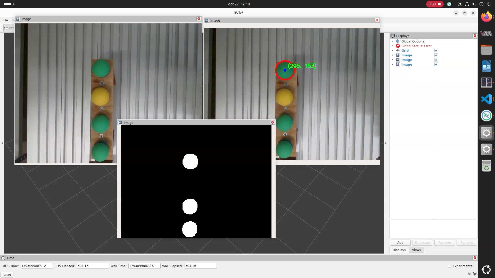

# UFactory ROS2 - ViSens

Dockerfile PC-AMD64 no está bien (hay que revisarlo)

## Descargar Tilix
```bash
sudo apt update && sudo apt install tilix -y
```

## Descargar la imagen Docker
<!--Si quieres construir la imagen, ejecuta el script ``build.sh``
```bash
sudo chmod u+x build
./build.sh
```-->

```bash
docker pull visensehu/xarm_ros2:jazzy
```

## Ejecutar la imagen Docker
Si estamos en el ordenador personal (sin GPU Nvidia):
```bash
sudo chmod u+x run_eib.sh
./run_eib.sh
```

Si estamos en el servidor (con GPU Nvidia):
```bash
sudo chmod u+x run.sh
./run.sh
```

Si se quiere acceder desde otra terminal al contenedor activo:
```bash
docker exec -it xarm_ros2 bash
```

## Ejecutar ejemplos
Info: 
- https://docs.docker.com/engine/install/ubuntu/,
- https://docs.docker.com/engine/install/linux-postinstall/,
- https://docs.ros.org/en/jazzy/index.html, 
- https://github.com/xarm-Developer/xarm_ros2/tree/jazzy, 
- https://github.com/xArm-Developer/xarm_ros2/tree/jazzy/xarm_api, 
- https://github.com/xArm-Developer/xArm-Python-SDK/tree/master/doc/api

xArm6, Gazebo + RViz:
```bash
ros2 launch xarm_moveit_config xarm6_moveit_gazebo.launch.py
```

UF850, Gazebo + RViz:
```bash
ros2 launch xarm_moveit_config uf850_moveit_gazebo.launch.py
```

xArm6 real + RViz:
```bash
ros2 launch xarm_moveit_config xarm6_moveit_realmove.launch.py robot_ip:=192.168.1.238 [add_gripper:=true] [auto_enable:=true] 
```

**Recordar que el xArm6 está montado en el motor lineal y, por tanto, con la controladora PRO, cuya dirección IP es: 192.168.1.211.**

UF850 real + RViz:
```bash
ros2 launch xarm_moveit_config uf850_moveit_realmove.launch.py robot_ip:=192.168.1.234 [add_gripper:=true] [auto_enable:=true] 
```

Con alguno de los dos procesos anteriores ejecutados (los que mueven el robot real), desde otra terminal podemos ejecutar trayectorias o movimientos llamando a los temas (topics), servicios y acciones definidos en ROS2. A continuación se muestran algunos ejemplos para el xArm6 (para el UF850 habrá que cambiar el nombre del tema). Lo primero de todo será activar el modo de operación correpondiente:
```bash
# enable all joints:
ros2 service call /xarm/motion_enable xarm_msgs/srv/SetInt16ById "{id: 8, data: 1}"

# disable
# ros2 service call /xarm/motion_enable xarm_msgs/srv/SetInt16ById "{id: 8, data: 0}"

# set proper mode (0) and state (0)
ros2 service call /xarm/set_mode xarm_msgs/srv/SetInt16 "{data: 0}"
ros2 service call /xarm/set_state xarm_msgs/srv/SetInt16 "{data: 0}"

# si activamos el modo 7, poder comandar una posición y cambiarla sin esperar a que termine el movimiento
ros2 service call /xarm/set_mode xarm_msgs/srv/SetInt16 "{data: 7}"
```

Movimiento cartesiano del efector (XYZ, en mm):
```bash
ros2 service call /xarm/set_position xarm_msgs/srv/MoveCartesian "{pose: [300, 0, 250, 3.14, 0, 0], speed: 50, acc: 500, mvtime: 0}" 
```

Movimiento independiente de las joints (en radianes):
```bash
ros2 service call /xarm/set_servo_angle xarm_msgs/srv/MoveJoint "{angles: [-0.58, 0, 0, 0, 0, 0], speed: 0.35, acc: 10, mvtime: 0}"
```

Si creamos un nodo de ROS2 para ejecutar esos servicios, antes de lanzar nuestro nodo personalizado hay que lanzar el controlador del robot, desde otra terminal:
```bash
# launch xarm_driver_node:
ros2 launch xarm_api xarm6_driver.launch.py robot_ip:=192.168.1.211
```
y acordarnos de activa el correspondiente modo de operación. En lugar de hacerlo desde terminal, se hará desde el propio nodo de Python.


## Ejemplo ejecución del nodo de ejemplo
Ir al directorio del workspace (espacio de trabajo)
```bash
cd /home/$USER/ws
```

Compilar el workspace (que podrá contener tantos paquetes como queramos):
```bash
colcon build
```

Activamos los paquetes compilados:
```bash
source /home/$USER/ws/install/setup.bash
```

En una terminal ejecutar el driver:
```bash
ros2 launch xarm_api xarm6_driver.launch.py robot_ip:=192.168.1.211
```

Desde otra terminal, primero, configurar el modo de operación:
```bash
ros2 service call /xarm/set_mode xarm_msgs/srv/SetInt16 "{data: 0}"
ros2 service call /xarm/set_state xarm_msgs/srv/SetInt16 "{data: 0}"
```

Y segundo, ejecutar el nodo:
```bash
ros2 run ejemplo ejemplo
```

Si ejecutamos el launcher (que ejecutar automáticamente el driver y el nodo):
```bash
ros2 launch ejemplo ejemplo.launch.py 
```

**Pero recuerda: el nodo no configura automáticamente el modo de operación, por lo que si lanzas el launcher, el robot no se moverá hasta que los configures desde terminal**-

<!--
```
cd ~/dev_ws/
# launch xarm_driver_node:
ros2 launch xarm_api xarm6_driver.launch.py robot_ip:=192.168.1.117

# enable all joints:
ros2 service call /xarm/motion_enable xarm_msgs/srv/SetInt16ById "{id: 8, data: 1}"

# disable
ros2 service call /xarm/motion_enable xarm_msgs/srv/SetInt16ById "{id: 8, data: 0}"

# set proper mode (0) and state (0)
ros2 service call /xarm/set_mode xarm_msgs/srv/SetInt16 "{data: 0}"
ros2 service call /xarm/set_state xarm_msgs/srv/SetInt16 "{data: 0}"

# Cartesian linear motion: (unit: mm, rad)
ros2 service call /xarm/set_position xarm_msgs/srv/MoveCartesian "{pose: [300, 0, 250, 3.14, 0, 0], speed: 50, acc: 500, mvtime: 0}"   

# joint motion for xArm6: (unit: rad)
ros2 service call /xarm/set_servo_angle xarm_msgs/srv/MoveJoint "{angles: [-0.58, 0, 0, 0, 0, 0], speed: 0.35, acc: 10, mvtime: 0}"
```

``ros2 service call /xarm/set_servo_angle xarm_msgs/srv/MoveJoint "{angles: [0.5, 0.0, 0.0, 0.0, 0.0, 0.0], speed: 0.5, acc: 0.5, wait: true}"``

``ros2 service call /xarm/set_servo_angle xarm_msgs/srv/MoveJoint "{angles: [0.0, -0.7, -0.95, 0.0, 0.0, 0.0], speed: 0.5, acc: 0.5, wait: true}"``

Detecta colisión con si mismo: ``ros2 service call /xarm/set_servo_angle xarm_msgs/srv/MoveJoint "{angles: [0.0, 0.2, 0.1, 0.0, 0.0, 0.0], speed: 0.1, acc: 0.1, wait: true}"``

Códigos de error: https://github.com/xArm-Developer/xArm-Python-SDK/blob/master/doc/api/xarm_api_code.md

ros2 topic echo /xarm/robot_states

ros2 service type /xarm/motion_enable

# Para controlar el motor lineal desde ROS2

Hay que activar los servicios del motor lineal. Eso se hace en ``xarm_ros2/xarm_api/config/xarm_params.yaml`` o en la versión compilada en ``/home/xarm_ws/install/xarm_api/share/xarm_api/config/xarm_params.yaml``

```yaml
set_linear_motor_stop: false
clean_linear_motor_error: false
get_linear_motor_pos: true
get_linear_motor_status: true
get_linear_motor_error: true
get_linear_motor_is_enabled: true
get_linear_motor_on_zero: true
get_linear_motor_sci: true 
get_err_warn_code: false
get_linear_motor_sco: true    
set_linear_motor_enable: true 
set_linear_motor_speed: true
set_linear_motor_back_origin: true 
set_linear_motor_pos: true         
```


```bash
ros2 launch xarm_api xarm6_driver.launch.py robot_ip:=192.168.1.211
```

```bash
?? ros2 service call /xarm/set_linear_motor_enable xarm_msgs/srv/SetInt16 "{data: 1}" ??
```

```bash
ros2 service call /xarm/get_linear_motor_is_enabled xarm_msgs/srv/GetInt16 "{}"
```

```bash
ros2 service call /xarm/set_linear_motor_pos xarm_msgs/srv/LinearMotorSetPos "{pos: 650, speed: 150, wait: true, timeout: 100.0, auto_enable: true}"
```

-->

# Gripper
Activar los servicios correspondientes en `xarm_ros2/install/xarm_api/share/xarm_api/config/xarm_params.yaml`.

El fichero `xarm_params.yaml` ya lo incluye a modo de ejemplo.

```bash
ros2 service call /xarm/set_gripper_enable xarm_msgs/srv/SetInt16 "{data: 1}"
```

```bash
ros2 service call /xarm/set_gripper_mode xarm_msgs/srv/SetInt16 "{data: 0}"
```

```bash
ros2 service call /xarm/set_gripper_speed xarm_msgs/srv/SetFloat32 "{data: 1500.0}"
```

```bash
ros2 service call /xarm/set_gripper_position xarm_msgs/srv/GripperMove "{pos: 850}"
```

# Vision

Para visión utilizaremos "computación distribuida". Prerrequisito: https://github.com/ViSensEHU/rpi5-cameras

Las cámaras están conectadas a una Raspberri Pi 5 (8 GB RAM) cada una. Estas RPi ejecutarán los nodos de visión de la solución de ejemplo y mandarán por un tema de ROS2 (*topic*) la posición y el error de la pelota verde.

Después, el PC recibirá esa información por ROS2, y la utilizará para ejecutar el controlador desarrollador y el *driver* del robot de UFactory. 

A continuación se exponen los pasos seguidos para ejecutar la aplicación de ejemplo desarrollada.

## Raspberry Pi 5
Encender la Raspbery Pi 5 del robot xArm6. Conectarse por SHH (la contraseña es `xarm6`):
```bash
ssh xarm6@192.168.1.102
```

Hay que abrir varias terminales, por lo que se recomienda usar VSCode conectado a este dispositivo mediante SSH (`Open a remote window`):


Terminal 1:
```bash
cd /home/xarm6/Documents/rpi5-cameras
./run_rpi.sh
```

Una vez dentro del contenedor de la imagen de Docker, ejecutar el nodo de la cámara del robot:
```bash
ros2 launch realsense2_camera rs_launch.py camera_namespace:=xarm6 camera_name:=realsense
```

Terminal 2:
```bash
docker exec -it ros2_jazzy_realsense_vision bash
cd /home/xarm6/Documents/ufactory_ros2/ws
colcon build --packages-select vision_control
source install/setup.bash
ros2 launch vision_control green_follower.launch.py 
```

<br>

**NOTA**: para que la transmisión de la cámara por red funcione correctamente, es recomendable desconectar la Raspberry Pi 5 de `eduroam` (y en general, de cualquier otra red que no se utilice para la comunicación, y de cualquier otra red con el mismo *gateway*):
```bash
sudo nmcli connection down id eduroam
```

Para volver a activar la conexión a internet (pedirá las credenciales de `eduroam`):
```bash
sudo nmcli --ask connection up id eduroam
```


<!--
Solucionar error de la hora, cambiar la fecha y hora desde terminal:
```bash
sudo timedatectl set-time "2026-10-27 11:24:00"
```

```bash
ros2 run vision_control green_filter
```
-->

## PC
Terminal 1:
```bash
cd /home/$USER/Documents/ufactory_ros2
./run_eib.sh
ros2 launch xarm_api xarm6_driver.launch.py robot_ip:=192.168.1.211
```

Terminal 2:
```bash
docker exec -it xarm_ros2 bash
ros2 service call /xarm/motion_enable xarm_msgs/srv/SetInt16ById "{id: 8, data: 1}"
ros2 service call /xarm/set_mode xarm_msgs/srv/SetInt16 "{data: 7}"
ros2 service call /xarm/set_state xarm_msgs/srv/SetInt16 "{data: 0}"
cd /home/javierarambarricalvo/Documents/ufactory_ros2/ws
colcon build --packages-select vision_control
source install/setup.bash

# Si solo queremos que vaya a la pelota
ros2 run vision_control xarm_visual_servo_controller

# Si queremos la aplicación de grasping, ejecutar solo:
ros2 launch vision_control grasping.launch.py
```

Si queremos visualizar las imágenes, podemos abrir RViz2 en la Terminal 3:
```bash
docker exec -it xarm_ros2 bash
cd /home/javierarambarricalvo/Documents/ufactory_ros2/ws
source install/setup.bash
rviz2
```

